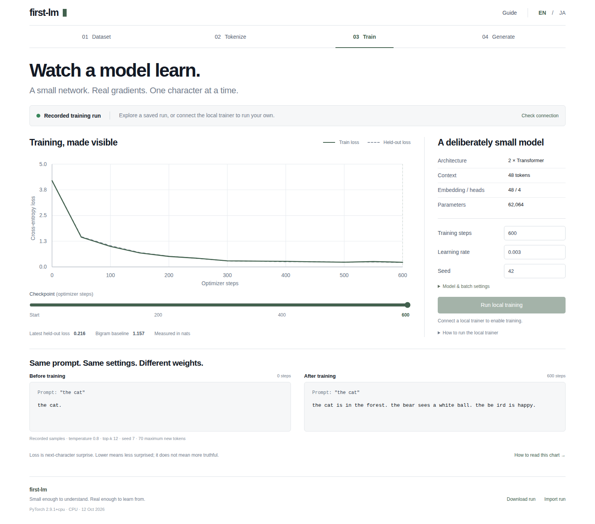

# first-lm

小さな言語モデルをランダムな重みから実際に学習させ、その変化を観察する実験室です。

**62,064 パラメータの decoder-only Transformer** を Python / PyTorch で学習します。英語・日本語に切り替えられる React UI で「データ → 文字と ID → 学習 → 生成」を追えます。事前学習済みモデル、外部 AI API、有料 GPU は使いません。短い定型文に特化した教材であり、実用的なチャットボットではありません。



実際の Chromium 画面です。数値と生成文は保存した学習実行の結果を表示しています。

## デモの中で仕組みを学ぶ

画面右上の **ガイド**、または **仕組みを学ぶ** から、8 章の教材を読めます。「なぜ必要か」から始め、「内部の流れ」「数式とコード」を必要に応じて開けます。

- 学習で重みが変わる流れと、学習後に固定した重みで文章を作る流れ
- 実際の文字・位置の埋め込みの数値
- 実際の次の文字の確率と、その 1 文字の損失
- 同じ条件で重みだけ／温度だけを変えて比べる実験

各章には `#/learn/loss` などの直接リンクがあり、ブラウザーの戻る・進むにも対応します。読んでいる間も実験の入力と生成結果は残ります。構造を示す図と実測値は区別し、説明のために架空の注意重みや勾配を表示することはありません。

## 2つの動作モード

- **ローカルで実際に学習**: Python サーバーを起動すると、ブラウザから CPU 学習・停止・保存・再開ができます
- **実測済みの記録を確認**: 静的サイトでは、実際の学習ログを表示します。文章の生成は、保存した本物の重みを使ってブラウザ内で計算します。静的サイトで Python が動いているようには表示しません

## 起動

Python 3.11/3.12 と Node 22.12 以降または 24 を用意します。以下は macOS / Linux の例です。

```sh
python3 -m venv .venv
source .venv/bin/activate
python -m pip install -r requirements.txt
# macOS
python -m pip install torch==2.9.1
# Linux / Windows の CPU 専用版はこちら
# python -m pip install torch==2.9.1 --index-url https://download.pytorch.org/whl/cpu
npm ci
npm run build
python -m pip install -e . --no-deps
python -m model_lab serve
```

http://127.0.0.1:8765 を開きます。ターミナルは起動したままにしてください。外部ネットワークに公開するためのサーバーではありません。Windows PowerShell では仮想環境の有効化を `.venv\Scripts\Activate.ps1` に置き換えてください。

記録の閲覧とブラウザ内生成だけなら `npm ci` → `npm run dev` でも動作します。

## 同じ実験を再現

```sh
python -m model_lab train --steps 600 --output runs/my-run
python -m model_lab train --steps 900 --output runs/my-run --resume
```

`--steps` は追加回数ではなく、到達する合計ステップ数です。保存した optimizer と乱数状態も復元します。再開時に変更できるのは到達ステップ数と評価間隔だけです。新しい設定を試す場合は新しい実験を開始します。

自分のデータを使う場合は `--corpus my-text.txt` を指定します。空行で文書を区切ってください。上限は UTF-8 で 100 KB、10〜2,000 文書、各 8〜4,000 文字です。学習用の文字は最大509種類です。外部へのアップロードは行いません。ただしエクスポートには語彙・データの抜粋・重みが含まれるため、共有前に内容を確認してください。機密情報の学習用には設計していません。

## 何が分かるか

- 同じ入力・temperature・top-k・seed で学習前後を比較する
- 次の文字の確率分布と、そこからのサンプリングを観察する
- 学習 loss と検証 loss、単純な bigram モデルを比較する
- 文書を先に分割し、学習データだけから語彙を作る理由を理解する
- 設定を変更して学習し直し、保存・停止・再開を試す

同梱データは576件の自作定型文です。検証用文書にも同じ語彙や文型が含まれます。小さい loss は一般的な言語能力を示しません。生成された不自然な文も、そのまま表示します。

[詳しい教材](docs/GUIDE.md) · [測定方法](docs/METHOD.md) · [英語の詳しい起動・検証手順](README.md)
